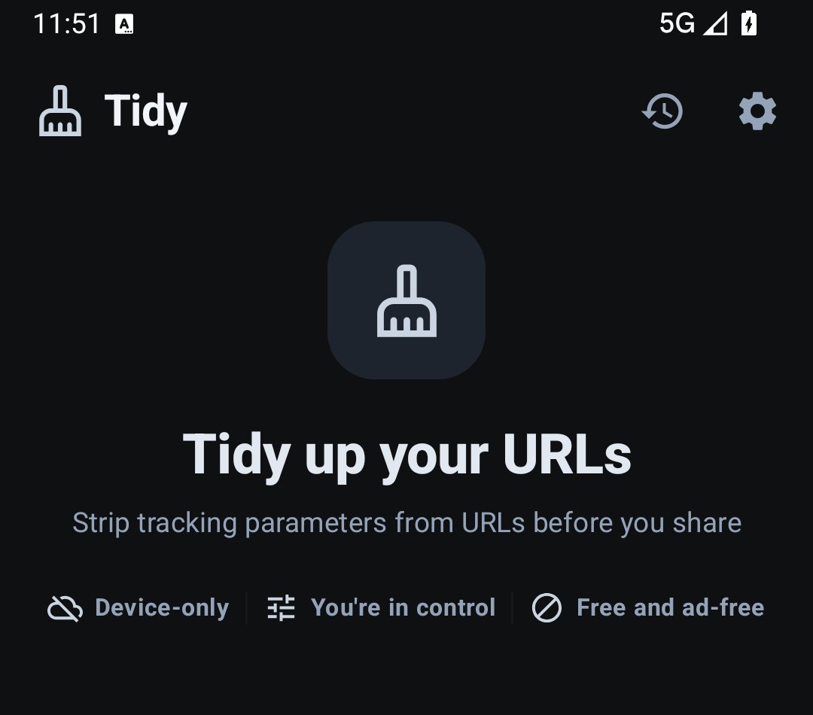
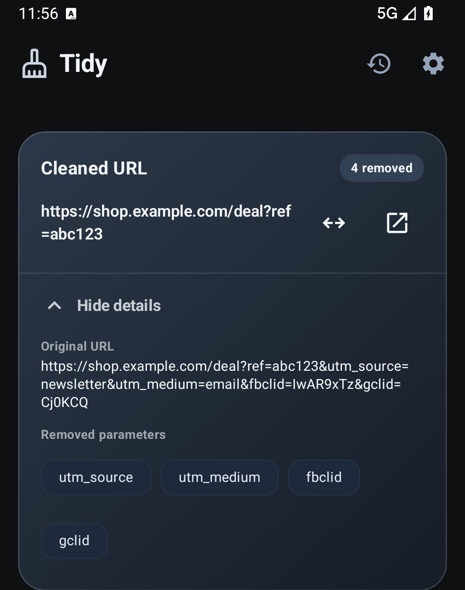
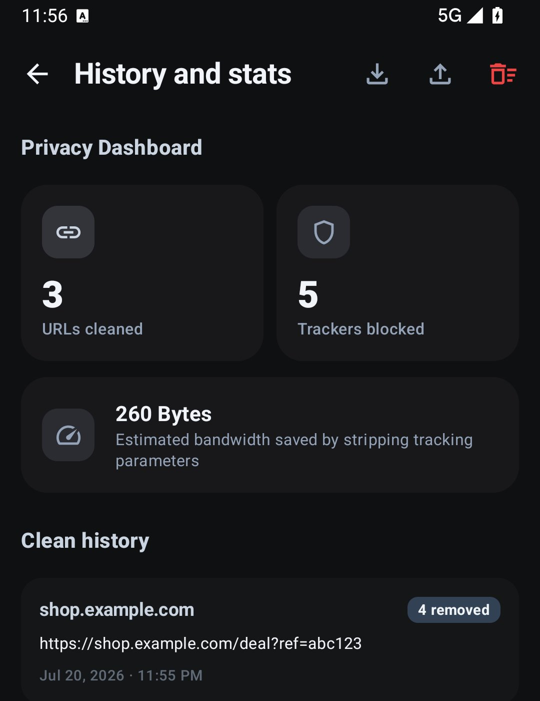

# Tidy

Control what a URL shares with strangers when you're just sharing it with a friend.

[](LICENSE)
[](https://developer.android.com)
[](https://kotlinlang.org/docs/multiplatform.html)

Ever copied a URL and wondered about the extra text at the end,
something like `?utm_source=facebook&fbclid=AbC123xyz`?
Those parameters can tell a service where a visit came from or connect it to an earlier click.
You wanted to share a page with a friend, not carry that extra information with it.

Tidy removes known tracking parameters before you share. You can see what changed and keep a parameter when you need it.

It's a small, free app. No account, no setup, no ads.
Cleaning happens on your phone and works offline from the first launch.
Optional URL expansion and rule updates use the network, as explained below.

<table>
<tr>
<td></td>
<td></td>
<td></td>
</tr>
</table>

Screenshots show an earlier version of Tidy.

---

## What it does

Read Tidy's [Privacy policy](https://arpitnnd.github.io/Tidy/privacy/) and
[Terms of use](https://arpitnnd.github.io/Tidy/terms/).

Share a URL to Tidy, or paste one in, and see the cleaned result.
Tidy removes matching tracking parameters and supported mobile subdomains.
With expansion enabled, it also follows short URLs such as `bit.ly` and `t.co`. It cleans automatically
as you paste or type, with explicit actions whenever you want them.

You stay in charge of the rules, not just the outcome:

- **Know what was removed, and why.** Tap any stripped parameter to see
  what it actually was. `fbclid`, for instance, is Facebook's way of
  tying a click back to you. Whitelist it for that one domain in a
  single tap, or flag a rule as wrong straight into a prefilled GitHub
  issue.
- **Whitelisting with nuance.** Keep `v` on `youtube.com` while
  stripping it everywhere else. Add your own rules where the defaults
  don't fit.
- **A record, entirely yours.** History keeps original and cleaned URLs, with open/copy actions and JSON export and import.
  It also shows lifetime cleaning totals. The bandwidth figure estimates removed URL text, not measured network savings.
  Saved History stays in the app unless you export it or opt in to Android system backup.

When you share a message, Tidy preserves its surrounding text and replaces only the first detected URL.
History saves the URL pair, not the message.

### Fewer steps between copy and share

- **Quick Settings tile.** Clean whatever's on your clipboard from the
  notification shade, no app launch required.
- **Clipboard checking.** Off by default. Turn it on and choose how
  far it goes, from a quick review prompt up to fully automatic.
- **Share to Tidy.** Same choice for shared URLs: see the cleaned
  result, or let Tidy copy and even re-share it for you.
- **Clean from anywhere** (Tidy+). Where an app supports Android's text-selection actions, select a URL and tap *Clean with Tidy*. No switching apps to do it.

---

## When Tidy uses the network

Tidy's tracker blocklist lives in this repository. The app checks for updates while it is open,
so new rules can reach you without an app update. These requests contain no input URLs or History.
Fresh installations use bundled rules throughout their first session unless you request a refresh.
Every change to the blocklist is public: [see the history for yourself](../../commits/main/blocklist).

Short-URL expansion needs the network too. Expanding `bit.ly/xyz` means asking where it goes.
The request travels from your phone to that server and any redirect destinations.
Those services receive the URL and normal connection information, including your IP address.
Tidy has no server in between. You can disable automatic expansion in Settings.

Sharing, opening URLs and exporting data pass information to the app or service you choose.
The Play edition also uses Google Play for purchases and restoring purchase access.
Cleaning itself stays on your phone.

---

## No remote crash reporting, no analytics, on purpose

There's no analytics SDK or automatic crash upload. You choose whether to share a diagnostic report.

If Tidy crashes, the report stays on your device. Find it under
**About**: read it, delete it, or share it
yourself through the system share sheet if you want to help. Crash reports are never uploaded automatically.

The same goes for Android's Auto Backup (Google account or ADB). Tidy blocks
these by default to prevent silent cloud uploads of your settings and
sanitisation history. You can opt in any time under **Settings → Data & backup**.
Opted-in backups include only History, rules, settings and your backup choice.
Diagnostics and cached purchase receipts are excluded. Turning backup off does not delete earlier copies held by the backup provider.

An app that claims zero remote logging shouldn't ask you to trust that
blindly. The code's right here. Go check.

---

## Tidy and Tidy+

Tidy is free and open source, and free isn't a trial here. Everything
that gives you control, the cleaning engine, custom rules, domain parameter
exceptions, unlimited history, your own backups, stays free, for good.

**Tidy+** is a one-time unlock on Google Play for people who already
trust how Tidy behaves and want a few fewer taps: the upper tiers of
clipboard and share automation, cleaning through Android's text-selection menu, extra
themes. It's also how this stays a real, maintained project instead of
an app that quietly stops getting updates. No ads, no subscription, no
data collected to sell instead.

Zero subscription. Pay once, own forever.

> Tidy+ isn't live yet. The [GitHub build](../../releases) works today. Tidy+
> is finishing testing before it lands on Google Play, and this README
> will update the moment it does. Think of the table below as a preview
> of what's coming.

| Feature | **Tidy** | **Tidy+** |
| --- | --- | --- |
| Cleaning engine and short-URL expansion | Yes | Yes |
| Custom rules and domain parameter exceptions | Yes | Yes |
| Unlimited History and History export/import | Yes | Yes |
| Opt-in Android system backup | Yes | Yes |
| Quick Settings tile | Yes | Yes |
| Clipboard checking, review before copying | Yes | Yes |
| Clipboard checking, auto-copy or auto-clean | No | Yes |
| Share to Tidy, view the cleaned URL | Yes | Yes |
| Share to Tidy, auto-copy or auto-share | No | Yes |
| Text-selection cleaning | No | Yes |
| Extra themes | No | Yes |

## Installing

Same app, two doors in:

- **[GitHub Releases](../../releases)**: open source, no Play account
  needed. You update it yourself, whenever you check back.
- **Google Play**: coming soon. Tidy+ and automatic updates will live
  here once the listing is public.

They're signed separately and install as two distinct apps. Switching
from GitHub to Play later takes one export and one restore. Tidy walks
you through it on first launch.

---

## Design

Built to Material 3 Expressive, in a quiet, nature-leaning palette:
forest slates, moss charcoal, sage green. Inputs sit low enough for a
thumb to reach without adjusting your grip. Nothing here is trying to
be noticed. A tool you'll open twenty times a day should feel like part
of the phone, not an occasion.

---

## For developers

Kotlin Multiplatform, split cleanly between core logic and the Android
client:

- **`:shared`**: `UrlCleaner` (the parameter-stripping and whitelisting
  engine), `UrlDetection` (the single loose "looks like a URL" check
  used everywhere a URL needs spotting), `SettingsRepository`
  (DataStore-backed rules, stats, and tiered automation settings).
- **`:app`**: Compose UI (Navigation3), share-intent handling, the
  Quick Settings `TileService`, and `UrlExpander` for redirect
  resolution.
- **`:design-system`**: Shared Compose Styles, component surfaces and
  Settings card tokens. See the [design system guide](docs/design-system.md).

I use AI-assisted tools for code and drafting. I remain responsible for what I review and release.

**Build setup:** Use Android Studio's bundled JBR for the IDE's Gradle
JDK and `JAVA_HOME` (JBR 25 or newer). Install Android SDK platforms 37 and
37.2; Compose modules compile against 37.2. The app supports Android 7.0 (API 24) and
newer, targets API 37 and uses Java and Kotlin JVM 25 bytecode targets.
CI and release workflows use JDK 25. Android's supported library APIs still
depend on the device API level; the bytecode target does not add JDK 25 APIs.

The project uses preview AGP and Compose alpha dependencies. Versions
are pinned in [the version catalogue](gradle/libs.versions.toml) and
[Gradle wrapper](gradle/wrapper/gradle-wrapper.properties). Native
screenshot test suites require Android Studio Rabbit 1 Canary 4 or newer.

The `foss` flavour builds independently and works without Google Play Services.
The `play` flavour requires the closed-source `:feature-plus` module.
The commands below build and check FOSS.

### Building and testing

```bash
# Compile and build the FOSS flavour APK
./gradlew :app:assembleFossDebug

# Run unit tests
./gradlew :shared:testAndroidHostTest
./gradlew :app:testFossDebugUnitTest

# Run lint checks
./gradlew lintFossDebug

# Compare Compose previews with their reference images
./gradlew :app:testFossDebugScreenshotTestDefaultTestSuite
```

See [Contributing](CONTRIBUTING.md#screenshot-tests) for screenshot
reports, reference-image review and update commands. On Windows, use
`gradlew.bat` in place of `./gradlew`.

---

## Contributing

Bug fixes, blocklist corrections, and improvements to the `foss`
flavour are welcome. See [CONTRIBUTING.md](CONTRIBUTING.md) for setup,
code style, and how to submit changes.

There's no iOS app, and I likely won't be the one to build it. I'm on
Windows, I'd rather not take on another platform to context-switch
into, and this project already uses up what spare time I have. If
you'd like to bring Tidy to iOS, I'd genuinely welcome the help.

---

## Security policy

If you discover a security vulnerability in Tidy, please report it
privately via the **Security** tab on GitHub rather than opening a
public issue. See [SECURITY.md](SECURITY.md) for details on scope and
disclosure.

---

## Licence

Apache License 2.0. See [LICENSE](LICENSE).
